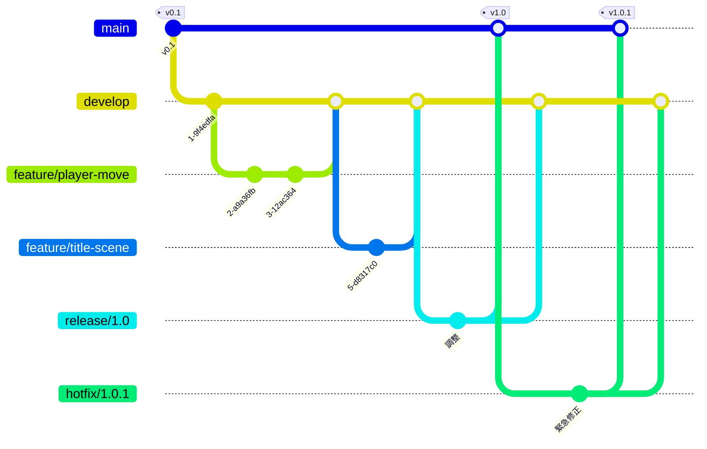

# ブランチ運用ルール

このプロジェクトは **git-flow** という方法でブランチを分けて開発する。

## 全体像

## ブランチの種類

| ブランチ | 役割 | 作る元 | 入れる先 | 誰が触れるか |
|---|---|---|---|---|
| `main` | 完成品（提出・発表するバージョン）。タグ `v1.0` などを付ける | — | — | **管理者がプルリクエストでマージするだけ**。直接 push は誰もできない |
| `develop` | 開発中の最新。みんなの作業はここに集まる | `main` | — | **管理者がプルリクエストでマージするだけ**。直接 push は誰もできない |
| `feature/〇〇` | 1つの機能・作業ごとのブランチ | `develop` | `develop` | **全員**が作れる。メンバーはここだけで作業する |
| `release/〇〇` | 提出前の調整（バグ修正だけ。新機能は入れない） | `develop` | `main` と `develop` | **管理者だけ** |
| `hotfix/〇〇` | 提出後に見つかった重大なバグの修正 | `main` | `main` と `develop` | **管理者だけ** |

## 役割と権限

| | 管理者（2人） | 開発者（メンバー） |
|---|---|---|
| GitHub の権限 | Admin | Write |
| `feature/*` を作る・push する | ○ | ○ |
| `develop` へのプルリクエストを作る | ○ | ○ |
| `develop` / `main` にマージする | ○ | ✕（GitHub が止める） |
| `release/*` / `hotfix/*` を作る | ○ | ✕（GitHub が止める） |
| タグ（`v1.0` など）を付ける | ○ | ✕（GitHub が止める） |
| `feature/` 以外の名前のブランチを作る | ○ | ✕（GitHub が止める） |

「GitHub が止める」は、GitHub の **Rulesets**（リポジトリの Settings → Rules）で設定している。
`tools/admin/setup-repo.ps1` が自動で作る。

## 名前の付け方

- フィーチャーブランチ：`feature/` ＋ **英小文字・数字・ハイフン**。何の作業か分かる名前にする。
  - 良い例：`feature/player-move`、`feature/title-scene`、`feature/fix-camera-shake`
  - 悪い例：`feature/test`、`feature/tanaka`（何の作業か分からない）
- リリース：`release/1.0`、ホットフィックス：`hotfix/1.0.1`（バージョン番号）
- 1つのフィーチャーブランチは **1つの機能**。大きくなりすぎたら分ける（目安：数日で終わる大きさ）。

## コミットメッセージ

日本語でOK。**何をしたか**が分かるように書く。

- 良い例：`プレイヤーを WASD で移動できるようにした`、`タイトル画面の背景を追加`
- 悪い例：`修正`、`いろいろ`、`aaa`

## マージ方法

マージは **マージコミット** だけ（Squash / Rebase は無効にしてある）。上の図のように枝分かれの履歴が残る。
